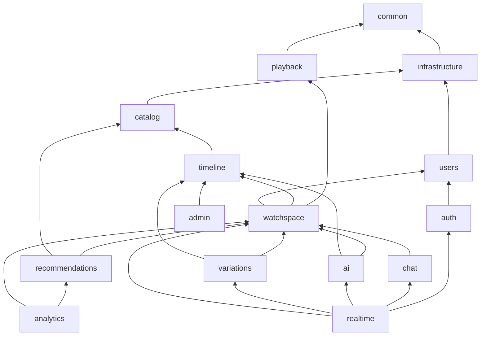

Warning: truncated output (original token count: 32738)
Total output lines: 1496

# AI Watch Spaces — Backend System Design

**Status:** Design baseline v0.4, with current product direction updated by the user on 2026-11-20. M1 (infrastructure), M2 (auth) and M3 (catalogue/timeline APIs) are implemented. M4 room lifecycle is now authorized and underway. The current MVP is the non-AI watch-party site: catalogue, room creation/join, playback sync, chat, and presence. Subtitle tracks/variations, timeline UI, recommendations, analytics, and AI features are deferred until that core path works; AI is planned as a later integration phase.

**Product scope:** the September 2026 PRD remains the long-term requirements reference. The user's 2026-11-20 direction supersedes its AI-first sequencing and feature scope for the MVP. This is a full-stack React + Spring Boot application using the PRD's Option A Java backend stack.

**Labels used in this document:**
- **[PRD]** — an explicit PRD requirement or acceptance criterion.
- **[DD]** — a design decision made here (not stated by the PRD). Deliberate deviations from the PRD are collected in §14.

**What changed from v0.1 (v0.2):** every Critical (C1–C6) and Important (I1–I26) audit finding is resolved; Appendix A maps each finding to its section. Optional findings (O1–O11) are recorded in §16 and deliberately **not** implemented.

**What changed from v0.3 (v0.4, M0.2):** `flyway-database-postgresql` is mandatory; subtitle-track integrity for `SUBTITLE_TRACK_SWAP` options and room pinning is defined (Appendix C).

**What changed from v0.2 (v0.3, M0.1):** see Appendix B. In short:
- OD-1 resolved: Spring Boot **4.1.2** on Java 21, with Jackson 3, Hibernate 7 and json-schema-validator 3.x (ADR-002), plus an M1 verification checklist for every detail not confirmed from official sources.
- Deterministic session-analytics reconciliation: one canonical instant per mutation (ADR-005, §9.4).
- Refresh-token replay: the family revocation commits before `401 REFRESH_TOKEN_REUSED` is returned (§8.2).

> The PRD uses Netflix branding as a project scenario but rules out integration with real Netflix infrastructure, accounts, catalogues or user data. Use self-created/sample titles and lawfully usable sample video only.

---

## 1. Goals and scope

The backend must support:

1. Registration/login, short-lived JWT access tokens, rotating refresh tokens with replay rejection. [PRD §10.1]
2. A title catalogue and admin-managed, validated, versioned timeline metadata. [PRD §6.2, §6.3]
3. Creating, joining (code or link), locking, leaving, ending and moderating Watch Spaces. [PRD §6.1]
4. Server-held authoritative playback state driven by the host, WebSocket fan-out, drift measurement/correction, presence with connection quality, reconnect, ordered persisted chat, reactions and typing indicators. [PRD §6.1]
5. Timeline-triggered and on-demand trivia, retrieval-grounded Q&A with cited sources, host-pinned facts, per-viewer locale subtitle alternates, host selection of approved variants and timed group voting. [PRD §5.1, §6.2]
6. Personal dashboard, past-room listing with analytics, hybrid recommendations, ratings. [PRD §6.3]
7. Proof through automated tests, a Postman collection and Java/JUnit scripted WebSocket clients instead of a UI. [PRD §4.3]
8. Reproducible setup, measured performance, API/event documentation and seed data. [PRD §12]

**Out of scope:** any frontend/UI, billing, CDN/DRM, real Netflix integrations, generation of plot/video/audio/subtitle content at watch time, multi-tenant or multi-instance deployment. [PRD §4.2]

---

## 2. Architecture decisions

### ADR-001 — Modular monolith

**Decision:** one Spring Boot application, one deployable, one PostgreSQL database, strictly separated feature modules (top-level Java packages). [DD, consistent with PRD §4.1 and §9.4]

**Why:** one engineer, one private/local deployment, four weeks. Microservices would add network contracts, distributed transactions and deployment overhead with no requirement for independent deployment. The PRD requires the real-time gateway and AI Content Engine to be *logically* separate, which module boundaries satisfy.

#### Module responsibilities

| Module | Owns |
|---|---|
| `common` | Error envelope, error codes, correlation IDs, clock abstraction, ID generation, plain-text validation, in-memory rate limiter. |
| `infrastructure` | Cross-cutting technology only: datasource/Hikari config, the bounded **database executor**, the AI executor/concurrency limiter, configured `WebClient` builder, local asset storage, structured logging, health/metrics wiring. It owns **no feature entities or repositories**. |
| `users` | `app_users` profile, locale, preferences. |
| `auth` | Registration, login, password hashing, JWT issuing/validation, `refresh_tokens` rotation/replay rejection, WebSocket token re-validation API. |
| `catalog` | `titles`, `genres`, `title_genres`. |
| `timeline` | Timeline upload/parse/validate/publish, `title_timeline_versions`, `timeline_events`, `variation_options` (writes), versioned read API and per-version event cache. |
| `playback` | **Pure domain, no Spring/DB:** playback state machine, authoritative clock maths, drift and correction policy, connection-quality classification. |
| `watchspace` | **Room runtime kernel:** per-room serialized mutation lane, in-memory authoritative room state, sequence/stateVersion allocation, the `room_events` ledger, room lifecycle, membership, moderation, invites, settings, host disconnect/promotion, recovery, idle auto-end, timers. Defines the SPIs other modules plug into (below). |
| `chat` | `chat_messages`, chat history queries, plain-text chat policy, typing/reaction validation. |
| `ai` | Retrieval, prompt construction, LLM provider adapter, grounded-answer validation, `ai_questions`, `ai_answer_sources`, `ai_pinned_facts`, proactive and on-demand trivia. |
| `variations` | `subtitle_tracks`, `subtitle_cues`, room subtitle pinning, per-viewer locale alternates, votes/ballots, host selection, `room_variation_applications`, variant suggestions. |
| `recommendations` | `title_interactions` (derived), `title_ratings`, hybrid scorer, offline evaluation. |
| `analytics` | `watch_space_analytics`, ledger-derived metrics, `/me/dashboard` and past-room listing aggregation. |
| `admin` | Admin REST controllers only; delegates to `catalog`/`timeline`; no domain logic. |
| `realtime` | WebSocket transport only: handshake, session registry, inbound parsing/limits, routing to module services, outbound fan-out, slow-consumer policy. Implements `RoomBroadcaster`. |

#### Dependency direction (acyclic, compile-time)



(Arrows point from a module to what it depends on. Every module may also use `common` and `infrastructure`.)

Rules:

- A module calls another module only through that module's public application-service interfaces and DTOs. No module touches another module's entities or repositories.
- `watchspace` never depends on `chat`, `ai`, `variations`, `analytics`, `recommendations` or `realtime`. It reaches them through SPIs it defines and they implement (dependency inversion):
  - `RoomBroadcaster` — implemented by `realtime`; delivers committed server events to sessions.
  - `RoomTickHandler` — implemented by `ai` (proactive trivia) and `variations` (vote close at marker); invoked inside the lane on each playback tick.
  - `RoomLifecycleListener` — implemented by `variations` (cancel open votes), `recommendations` (interaction derivation) and `analytics` (snapshot); invoked after commit for lifecycle events.
- Business logic lives in application services, never in controllers or WebSocket handlers.
- Boundary enforcement in M1: package structure, package-private implementation classes, and code review. An automated architecture test tool is deferred (O2).

**Extraction seams for the future (not for the MVP):** realtime gateway (needs distributed room ownership + pub/sub), AI Content Engine, recommendation jobs.

### ADR-002 — Technology and version pinning

**Decision:** Java 21 LTS, Spring Boot **4.1.2**, Maven, PostgreSQL 17. [DD; stack is PRD Option A. Resolves OD-1 in v0.3.]

**Why 4.1.2 rather than 3.5.16:** the 3.5 line ended free OSS support on 2026-06-30 (3.5.16 was its final OSS release). 4.1.2 was released on 2026-10-23 and is on a supported line. Moving now, before any code exists, avoids a forced major migration (Jackson 2→3, Hibernate 6→7, Spring Framework 6→7) in the middle of the build.

#### Verified from official sources during M0.1

| Fact | Source |
|---|---|
| Spring Boot 4.1.2 was released 2026-10-23 and is available from Maven Central. | spring.io release announcement |
| 4.1.2 requires Java 17+ (compatible up to Java 27), Spring Framework 7.0.10+, and Maven 3.6.3+. Java 21 is therefore supported. | Spring Boot 4.1 "System Requirements" documentation |
| Spring Boot 4 uses **Jackson 3** as its preferred JSON library. The Jackson 2 support module ships only in deprecated form. Jackson properties moved under `spring.jackson.json.*`. | Spring Boot 4.0 Migration Guide |
| Modular starters: Flyway auto-configuration needs `spring-boot-starter-flyway`. The resource-server starter is `spring-boot-starter-security-oauth2-resource-server` (the old `spring-boot-starter-oauth2-resource-server` name is deprecated). Test starters follow `spring-boot-starter-<technology>-test` and bring `spring-boot-starter-test` transitively. `@WithMockUser` needs `spring-boot-starter-security-test`. `hibernate-jpamodelgen` is replaced by `hibernate-processor`. | Spring Boot 4.0 Migration Guide |
| 4.1 removes everything deprecated in 4.0. The 4.1.0 dependency upgrades include Flyway 12.4.0, Spring Security 7.1.0 and Spring Data BOM 2026.0.0. 4.1 adds an optional lazy JDBC connection-fetch mode (`spring.datasource.connection-fetch`). | Spring Boot 4.1 Release Notes |
| `com.networknt:json-schema-validator` **3.x** targets Java 17+ and **Jackson 3**; 2.x targets Jackson 2. Minor releases may contain breaking API changes. 3.0.7 appears in the README; 3.0.8 is the newest version shown on Maven Central. | networknt GitHub README; Maven Central listing |

Exact BOM-managed versions for 4.1.2 (Hibernate ORM, Jackson 3, Testcontainers, PostgreSQL JDBC, HikariCP, SnakeYAML) could not be read from official pages reachable from the design environment. **They are not claimed here.** They are M1 verification items (table below).

#### Pinned choices

| Component | Pinned choice | Notes |
|---|---|---|
| JDK | Java 21 LTS (`maven.compiler.release=21`) | Within 4.1.2's supported range (17–27). |
| Build | Maven 3.9.x via Maven Wrapper | `maven-enforcer-plugin`: `requireJavaVersion [21,22)`, `requireMavenVersion [3.9,)`, `dependencyConvergence`, `banDuplicatePomDependencyVersions`. |
| Spring Boot | `spring-boot-starter-parent` **4.1.2** | Supported line. Never override individual Spring/BOM-managed versions. |
| Spring Framework / Security / Data | Managed by the Boot BOM (Framework 7.0.x ≥ 7.0.10; Security 7.1.x; Data 2026.0.x) | Exact patches recorded at M1. |
| Hibernate ORM | Managed by the Boot BOM — **Hibernate ORM 7.x** (exact minor/patch verified at M1) | JSONB via `@JdbcTypeCode(SqlTypes.JSON)` with a **Jackson 3** format mapper (M1-V5). Use `hibernate-processor` if a metamodel generator is ever needed. |
| HikariCP, PostgreSQL JDBC | Managed by the Boot BOM | `spring.datasource.connection-fetch` stays at its eager default (M1-V12). |
| Flyway | `spring-boot-starter-flyway` (managed, 12.x line per 4.1.0 notes) **+ `org.flywaydb:flyway-database-postgresql` (mandatory, version managed by the Boot BOM)** | PostgreSQL 17 is the only target database; the PostgreSQL support module is always declared. M1-V2 verifies resolution and migrations. |
| Jackson | **Jackson 3** (`tools.jackson.*` packages), managed by the Boot BOM | **No Jackson 2 `jackson-databind` on the classpath** and no `spring-boot-jackson2` module (M1-V6). |
| JWT | `spring-boot-starter-security-oauth2-resource-server` (Nimbus JOSE) | HS256 issuing/validation without a third-party JWT library. |
| JSON Schema validation | `com.networknt:json-schema-validator` **3.0.x**, exact patch pinned at M1 (≥ 3.0.8 if it converges) | 3.x = Jackson 3 line; 2.x is incompatible with this stack. Pin an exact version; review release notes before any upgrade. |
| YAML | `tools.jackson.dataformat:jackson-dataformat-yaml` (Jackson 3, BOM-managed) | Parsed to a Jackson tree only (§8.4). |
| Tests | `spring-boot-starter-webflux-test`, `spring-boot-starter-data-jpa-test`, `spring-boot-starter-security-test`, `spring-boot-testcontainers`, Testcontainers PostgreSQL module (BOM-managed coordinates, M1-V8) | Docker is required to run integration tests. |
| Database server | PostgreSQL **17.x** Docker image, pinned by minor tag at M1: **`postgres:17.11`** | Same tag for Compose and Testcontainers (OD-4). |

**Starters (complete list for the baseline):**
- `spring-boot-starter-webflux`
- `spring-boot-starter-security`
- `spring-boot-starter-security-oauth2-resource-server`
- `spring-boot-starter-data-jpa`
- `spring-boot-starter-validation`
- `spring-boot-starter-actuator`
- `spring-boot-starter-flyway` + `org.flywaydb:flyway-database-postgresql` (mandatory)
- `org.postgresql:postgresql`
- Jackson 3 `jackson-dataformat-yaml`
- `io.micrometer:context-propagation` (BOM-managed; not transitive in 4.1.2; required for ADR-003 §7, found at M1-V10)
- `json-schema-validator` 3.0.x
- Test starters listed above

**`spring-boot-starter-web` / `spring-boot-starter-webmvc` must not be on the classpath** — with Spring MVC present, Spring Boot selects MVC on a servlet container instead of WebFlux on Netty.

#### M1 verification checklist (nothing below is claimed as tested in M0/M0.1)

| ID | Verify at M1 | Pass condition / fallback |
|---|---|---|
| M1-V1 | Resolve `spring-boot-starter-parent:4.1.2` from Maven Central; run `mvn help:effective-pom`, `mvn dependency:tree`, `mvn enforcer:enforce`. | Record every resolved version in `docs/dependency-versions.md`. Spring Framework ≥ 7.0.10. |
| M1-V2 | `org.flywaydb:flyway-database-postgresql` resolves at the same version as the BOM-managed Flyway core (no explicit version in the POM), and Flyway applies all available migrations against the selected PostgreSQL 17 image (OD-4 tag) in Testcontainers and Docker Compose. | Both resolution and migration succeed; record the versions and image tag. If the module is not BOM-managed in 4.1.2, pin it to exactly the managed Flyway version and record why. The dependency itself is not optional. |
| M1-V3 | Starter name `spring-boot-starter-security-oauth2-resource-server` resolves in 4.1.2; reactive HS256 decoding (`NimbusReactiveJwtDecoder` with a secret key) and encoding (`NimbusJwtEncoder`) APIs in Spring Security 7.1. | Auth integration tests pass with HS256 tokens. |
| M1-V4 | Exact `json-schema-validator` 3.0.x patch; its Jackson 3 dependency converges with the Boot Jackson BOM. | `dependencyConvergence` passes; timeline schema tests pass. If it does not converge, stop and report — do not fall back to 2.x. |
| M1-V5 | Hibernate 7 JSON mapping for JSONB columns uses Jackson 3. | A JSONB round-trip test passes. If Hibernate's default JSON format mapper does not use Jackson 3, configure a Jackson 3 format mapper explicitly (`hibernate.type.json_format_mapper`); do not add Jackson 2. |
| M1-V6 | No Jackson 2 `com.fasterxml.jackson.core:jackson-databind` arrives transitively. Jackson 3 continues to use the `com.fasterxml.jackson.annotation` annotations artifact; confirm. | Enforcer `bannedDependencies` rule for `jackson-databind` 2.x and `spring-boot-jackson2`; any unavoidable exception documented with its reason. |
| M1-V7 | Jackson 3 YAML parsing with SnakeYAML `LoaderOptions` limits and `StreamReadConstraints` via Jackson 3 builder APIs. | §8.4 parser tests (aliases, nesting, size, duplicate keys) pass. |
| M1-V8 | Testcontainers version and PostgreSQL module coordinates managed by 4.1.2 (artifact names may differ from Testcontainers 1.x); `@ServiceConnection` for PostgreSQL. | Context-load test on Testcontainers PostgreSQL 17 passes. |
| M1-V9 | Modular test starters (`webflux-test`, `data-jpa-test`, `security-test`) provide `WebTestClient`, JPA test slices, `reactor-test` and security test support. | Add `reactor-test` explicitly only if not transitive. |
| M1-V10 | Reactor ↔ Micrometer context propagation configuration in Boot 4.1 (`spring.reactor.context-propagation=auto` or its replacement). | MDC propagation test across Netty → `db-*` thread hops passes. |
| M1-V11 | PostgreSQL 17 minor supported by the managed Flyway and JDBC driver versions. | Migrations and integration tests pass. |
| M1-V12 | Default of `spring.datasource.connection-fetch` (expected: eager). | Keep eager; the blocking-boundary test (ADR-003 §10) still detects connection acquisition off `db-*` threads. |
| M1-V13 | Structured logging and Actuator health groups (liveness/readiness, custom `realtime` indicator) under Boot 4.1 module layout. | Health and logging tests pass. |

**Support window:** published Spring support calendars list OSS support for 4.1.x until 2027-07. Confirm on the official Spring support page at M1 and record it in the README.

### ADR-003 — WebFlux with blocking JPA: execution rules

**Decision:** keep Spring WebFlux for REST and WebSockets [PRD §8–9] and Spring Data JPA/Hibernate for persistence [PRD §8–9], with a strict boundary. [DD]

1. **No blocking on Netty threads.** No JDBC/JPA call, `Thread.sleep`, blocking file I/O, or blocking HTTP call may run on a `reactor-http-nio-*` thread.
2. **One dedicated bounded database executor** (`db-*` threads), exposed as a Reactor `Scheduler`. Thread count **equals** `spring.datasource.hikari.maximum-pool-size` (default 10); startup fails if they differ. Bounded queue (default 500); rejection → `503 SERVICE_BUSY`. Hikari `connection-timeout` 2 s. Do not use the default `boundedElastic` scheduler for JDBC (its thread cap far exceeds the pool and would park threads on connection acquisition).
3. **Adapter pattern.** Controllers/handlers call a reactive façade, which wraps a blocking application service exactly once: `Mono.fromCallable(() -> service.op(principal, cmd)).subscribeOn(dbScheduler)`. `subscribeOn`/`publishOn` calls are not scattered through business logic.
4. **Transactions.** `@Transactional` (or `TransactionTemplate`) is used only on blocking methods that return plain values/DTOs. **No method that relies on a JPA transaction returns `Mono`/`Flux`.** (With only a `JpaTransactionManager`, Spring would try to apply reactive transaction semantics to a reactive return type and fail.) No transaction spans thread hops.
   - **Commit-then-reject rule.** An unchecked exception thrown out of a transactional method rolls the transaction back. When a request must be *rejected* but its side effects must still be *kept* (for example refresh-token replay revoking a token family, §8.2), the transactional method **returns an outcome value** (e.g. a sealed `RefreshOutcome`) instead of throwing. The transaction commits, and only then does the web adapter map the outcome to the error response. `noRollbackFor` is not used for this purpose.
5. **Explicit principal.** The `AuthenticatedUser` (userId, systemRole, token expiry) is resolved from the reactive security context at the edge and passed as a method argument into every blocking service. Services never read `SecurityContextHolder`, which is empty on `db-*` threads.
6. **DTO mapping inside the transaction.** Entities never leave the transactional method; there is no open-session-in-view in WebFlux. `spring.jpa.open-in-view=false`. Lazy associations are fetched explicitly (fetch joins / projections).
7. **Context propagation.** Logging MDC (correlationId, sessionCorrelationId, watchSpaceId, userId) propagates across Reactor and executor hops via Micrometer context propagation (Boot 4.1 configuration confirmed at M1-V10) and a decorating executor that copies MDC.
8. **Timers never mutate state directly.** Trivia ticks, vote deadlines, host-grace expiry, idle auto-end and end-of-title detection run on one shared scheduler thread that only **submits commands** to the affected room lane.
9. **LLM calls are non-blocking.** The provider adapter uses `WebClient` (reactive) with a concurrency limiter and timeout; it never runs inside the lane (§4.8).
10. **Test the boundary (M1).** An integration test wraps the `DataSource` and fails if a connection is acquired on any thread not named `db-*`. (BlockHound is deferred — O3.)

### ADR-004 — PostgreSQL is the system of record

Relational tables with real keys, composite foreign keys and CHECK constraints for users, rooms, membership, ledger, chat, AI Q&A, votes, interactions and analytics. JSONB only for type-specific timeline payloads, ledger payloads and validation errors. [PRD §7.2.2 guidance; DD for details]

No MongoDB, Redis, Kafka, vector database or separate search engine in the initial build; none is needed for the local/private acceptance criteria. Any addition requires an approved ADR first.

### ADR-005 — Room runtime kernel: one serialized mutation lane per room

**Decision:** the `watchspace` module owns, per room: the mutation lane, the in-memory authoritative state, sequence and `stateVersion` allocation, and the `room_events` ledger. [DD; resolves C1]

**Lane model.**

- A registry maps `watchSpaceId → RoomLane`. Lanes are created lazily on the first mutation for **any** room status (including `SCHEDULED`), and evicted after 10 minutes of inactivity when the room has no connected sessions and no pending timers.
- Each lane processes **one mutation at a time**, in arrival order, from a bounded queue (default 256; overflow → `503 ROOM_BUSY`). Many lanes share the database executor; a lane never holds a thread while idle.
- **Every** durable room mutation goes through the lane, whether it arrives by REST (create side effects, join, leave, start, end, settings, lock, invite rotation, mute, remove, host transfer, pin, on-demand trivia, vote open/ballot/cancel, host variant selection, AI question/answer publication) or by WebSocket (playback, chat, AI ask, ballot), or from a timer.
- Readers (snapshot, sync reports, presence) read an **immutable** `RoomState` published through an atomic reference after each successful mutation. They never block the lane.

**Mutation contract** (`RoomMutation<R>`, defined in `watchspace`, implemented by any module):

1. **Validate** against the current in-memory `RoomState` and the explicit principal (authorization included). Pure; no I/O.
2. **Decide**: compute the next state and the list of ledger events. Pure.
3. **Persist and commit** on the DB executor in one transaction:
   - Write the mutation's own rows (e.g. a chat message, a ballot).
   - Append its `room_events`, numbered `lastSequenceNo + 1 … + n`.
   - Update `watch_spaces` (snapshot columns, `state_version`, `last_sequence_no`) **with an optimistic guard**: `… WHERE id = :id AND last_sequence_no = :expected`.
   - For joins, also `SELECT … FOR UPDATE` the `watch_spaces` row and re-check capacity, lock, removal and privacy (R8).
4. **Apply**: only after a successful commit, publish the new immutable `RoomState`.
5. **Broadcast**: hand the committed server events to `RoomBroadcaster` in `sequenceNo` order.
6. **Complete** the caller's `Mono` (REST response or WebSocket ack).

**Failure handling.**

| Failure | Outcome |
|---|---|
| Validation fails | Typed error to the caller; no write, no state change, no broadcast. |
| Transaction fails (constraint, I/O) | Rolled back; in-memory state untouched; nothing broadcast; caller receives an error. A failed DB write is never reported as success. |
| Optimistic guard updates zero rows (an out-of-lane writer or stale lane) | Roll back; mark lane stale; re-hydrate state from the DB (`last_sequence_no`, `state_version`, snapshot, memberships, moderation, open votes); reject the command with `409 CONFLICT_RETRY`. |
| Broadcast fails for a session | Does not roll back. That session is closed; the client recovers through reconnect, snapshot and history. |
| Process crash between commit and broadcast | DB is authoritative; recovery (§4.13) re-hydrates and clients resync from the snapshot. |

**Sequence numbers** are never computed with `MAX(sequence_no)+1` per mutation. The lane hydrates `last_sequence_no` once from `watch_spaces` and advances it under the guard.

**Canonical mutation instant (deterministic timestamps).**
- Each lane mutation reads the injected `java.time.Clock` **exactly once**, at the start of its *Decide* step, and truncates the result to **microseconds** (`Instant.truncatedTo(ChronoUnit.MICROS)`), PostgreSQL's `timestamptz` precision. It is then clamped so it is never earlier than the room's previous `mutationInstant`, which makes instants non-decreasing in `sequence_no` order within a room even if the wall clock steps backwards. This value is the mutation's `mutationInstant`.
- Every timestamp written by that mutation uses this same value: every `room_events.occurred_at` it appends, and any room/membership/vote column it sets (`started_at`, `ended_at`, `host_disconnected_at`, `joined_at`, `left_at`, `closed_at`, `applied_at`, `playback_updated_at`, …). The in-memory `RoomState` carries the same value. Lane mutations also set `created_at`-style columns explicitly rather than relying on their `now()` defaults. No timestamp is taken from the database clock or read twice from the Java clock. (Defaults remain only for writes outside the lane, such as user registration.)
- When a lane hydrates, the previous instant is the `occurred_at` of the room's event at `sequence_no = last_sequence_no` (a single unique-key lookup).
- `room_events.occurred_at` therefore has **no database default**; the application must always supply it (enforced by `NOT NULL` without `DEFAULT`).
- Consequences relied on by analytics (§9.4) and interaction derivation (§4.12):
  - `watch_spaces.started_at` = `occurred_at` of `ROOM_STARTED`.
  - `watch_spaces.ended_at` = `occurred_at` of `ROOM_ENDED`.
  - `watch_space_participants.joined_at`/`left_at` = `occurred_at` of the corresponding `PARTICIPANT_JOINED` / `PARTICIPANT_LEFT` / `PARTICIPANT_REMOVED` / `ROOM_ENDED` event.
- Ledger ordering is always by `sequence_no`, never by `occurred_at`, because several events of one mutation share an instant.
- **`ROOM_ENDED` is the last ledger event of a room.** After it commits, the lane rejects any further append for that room (late AI answers and timers append nothing, §4.8).

**Ephemeral traffic** — typing, reactions, sync ping/report, connection quality — does not enter the lane or the ledger. It reads the published state and goes straight to `RoomBroadcaster` (rate-limited).

**Post-commit listeners.** `RoomLifecycleListener` callbacks (analytics snapshot, interaction derivation, cancelling open votes on end) run after commit as separate idempotent transactions submitted to the same lane. If one fails it is retried; recovery (§4.13) re-runs any that are missing.

**MVP limitation:** room runtime state is single-process. Many concurrent rooms are supported in one process, but not horizontal scaling across instances; that would require distributed room ownership and pub/sub and a new ADR. No code hard-codes a single room. [PRD §10.2]

### ADR-006 — Structured timeline retrieval (no vector search)

Retrieval runs over the room-pinned, author-written timeline version using time overlap, a recent window and keyword matching over **prior** entries (§4.8). The LLM only phrases answers from retrieved entries. No vector database. [DD consistent with PRD §6.2 and §7.2.2 guidance]

### ADR-007 — Only pre-authored, approved variations

The system only **selects** among approved `variation_options` and seeded subtitle tracks. Variant suggestions are produced by deterministic eligibility rules, not by a model. No model output can create or modify a subtitle line, asset or narrative branch. [PRD §4.2, §5.3, §14.2]

### ADR-008 — Schema management

`DATABASE_SCHEMA.sql` is the approved **target state**, not a migration. Flyway versioned migrations are written **per feature slice** (V1 auth … V7 recommendations/analytics, listed at the end of `DATABASE_SCHEMA.sql`). Applied together they must equal the target state. `spring.jpa.hibernate.ddl-auto` is `none` at runtime and `validate` in integration tests. Seed data is loaded by a separate, profile-gated seed step.

---

## 3. Component view

```mermaid
flowchart TB
    C[Postman / JUnit HTTP tests / JUnit scripted WebSocket clients]
    C -->|REST JSON| API[WebFlux REST controllers]
    C -->|WebSocket JSON| WS[realtime: WebSocket handler + session registry]
    API --> SEC[Spring Security reactive chain: JWT]
    WS --> SEC
    API --> SVC[Module application services]
    WS --> SVC
    SVC --> LANE[watchspace: per-room mutation lane + immutable RoomState + ledger]
    LANE -->|RoomTickHandler| AI[ai: trivia, Q&A]
    LANE -->|RoomTickHandler| VAR[variations: votes, subtitles]
    LANE -->|RoomBroadcaster| WS
    SVC --> DBX[db executor = Hikari pool size]
    LANE --> DBX
    DBX --> DB[(PostgreSQL 1…17738 tokens truncated…2, 4 and 5.

This test also provides the "fully manually verified test session" evidence: the fixture's expected values are written out by hand in the test.

---

## 10. Non-functional requirements and test evidence

| PRD requirement | Measurement |
|---|---|
| Non-AI REST P95 < 200 ms | JUnit-driven load profile; report endpoint, sample count, P50/P95/P99, hardware. |
| AI answer P95 < 3 s | End-to-end and provider latency from `ai_questions`; failures and timeouts reported too. |
| Drift < 100 ms target, < 250 ms ceiling | Scripted clients' reported drift before/after correction; network conditions stated; simulation caveat (§4.4). |
| Joiner synced within 250 ms in 2 s | Harness: time from socket open to first report within 250 ms of expected. |
| Host pause/seek reflected within 1 s | Server receive → last client receive timestamps. |
| Fan-out < 500 ms | Same, at 3, 10 and as many clients as hardware allows (target 50); report the tested count honestly. |
| Trivia < 1 s for ≥ 95 % of markers | Crossing time vs received time, including seek and reconnect scenarios. |
| Join success > 99 % | Harness counts attempts vs synchronized joins. |
| Precision@5 ≥ 0.6 | Fixed held-out set. |
| Trivia/context QA ≥ 90 % | Manual review of a fixed sample; record pass rate. |
| RBAC server-side | Negative tests, including rejected viewer token on host/admin actions. |
| Analytics reconcile exactly | §9.4 test. |

### Test strategy

**Unit tests:**
- Playback transition table (every row of §4.1).
- Clock and drift maths; correction modes; connection-quality classification.
- Vote tally, ties and no-vote default.
- Retrieval set selection and spoiler exclusion.
- AI output validation; plain-text policy; invite-code normalization.
- Interaction-coverage maths; recommendation scorer.

**Integration tests (Testcontainers PostgreSQL):**
- Flyway migrations equal the target schema.
- Constraint negatives (composite FKs).
- Refresh rotation and replay, including the committed-revocation tests of §8.2; RBAC.
- Analytics reconciliation with a controllable clock (§9.4) and canonical-instant equality (ADR-005).
- JSONB round-trip through Hibernate 7 with Jackson 3 (M1-V5).
- **Capacity race:** 20 concurrent joins into a capacity-5 room → exactly 4 succeed (the host holds one seat).
- **Lane failure injection:** forced DB error → no broadcast and unchanged `RoomState`.
- **Optimistic-guard conflict:** out-of-lane write → `CONFLICT_RETRY` and re-hydration.
- **Blocking boundary:** connection acquired only on `db-*` threads.
- Timeline publish/supersede; recovery re-hydration with a controllable clock.

**WebSocket tests (JUnit + JDK `java.net.http.WebSocket` scripted clients):**
- Host A + participants B/C: play/pause/seek.
- **Event ordering:** concurrent chat from 3 clients interleaved with host commands → every client receives a gap-free, identical `sequenceNo` order that matches the DB.
- Reconnect without duplicate join; host disconnect → promotion.
- Removed/muted enforcement; token renewal and 4401; slow consumer 4408.
- Trivia toggle; locale alternates do not change `stateVersion`.
- Vote close, apply and cancel-on-seek.

**Demonstration:** `@Tag("demo")` JUnit scenarios run with `mvn -Pdemo verify` print a readable transcript of the end-to-end flows (Track B replacement for screen recordings). [PRD §4.3]

---

## 11. Operations and observability

- **Docker Compose:** application + PostgreSQL 17; local asset directory volume. The LLM provider is external and configurable (OD-2).
- **Configuration:** `application.yml` holds defaults only; secrets and environment-specific values come from environment variables. All tunables in this document (grace periods, timeouts, thresholds, limits) are configuration properties with the stated defaults.
- **Correlation (I5):**
  - `correlationId` per HTTP request / WebSocket command (stored in `room_events.correlation_id`).
  - `sessionCorrelationId` per watch session (assigned at start, stored on the room, included in the snapshot) — tags every room and AI log line. [PRD §10.3]
- **Structured logs:** Spring Boot's built-in structured console logging (JSON). Every WebSocket room event and every AI request/response is logged with `watchSpaceId`, `sessionCorrelationId`, `eventId`, `sequenceNo`, `correlationId`, actor ID and latency, excluding sensitive fields.
- **Health (I5):** liveness; readiness = `db` + custom **`realtime`** indicator (WebSocket handler mapping registered, room registry responsive, DB executor and lane queues below saturation, not shutting down, recovery finished). [PRD §10.3: API and real-time gateway]
- **Metrics (Micrometer):** REST latency by route; connected sessions and rooms; lane queue depth and mutation latency; fan-out duration; drift distribution; AI end-to-end and provider latency and outcome counts; trivia lateness; join failures by code; reconnects; slow-consumer closes; timeline validation failures.

---

## 12. Implementation milestones

Each milestone ends with passing tests and a written report of what passed, failed or could not be run. Scope is cut before tests or documentation. [PRD §14.2]

| # | Milestone | Exit criteria |
|---|---|---|
| **M0 / M0.1 / M0.2** | Design revision, review revision and correction (this document, schema, CLAUDE.md) | **Approved 2026-10-26.** M1 authorized. |
| M1 | Maven scaffold (Spring Boot 4.1.2, Java 21), packages per module, Docker Compose, configuration, DB executor, error envelope, correlation filter, structured logging, health (incl. `realtime` stub), and the **M1 verification checklist M1-V1…V13** (ADR-002) | Context loads on Testcontainers PostgreSQL 17; enforcer (incl. Jackson 2 ban) passes; resolved versions recorded in `docs/dependency-versions.md`; each M1-V item reported as passed, failed or resolved by its documented fallback; health test; blocking-boundary test; JSONB round-trip with Jackson 3. |
| M2 | Flyway V1; register/login/refresh/logout; `/me`; reactive security chain; rate limiting for auth | 401/403/400 tests; TTL ≤ 1 h enforced; rotation; replay revokes the family **and the revocation is committed before the 401** (the three §8.2 tests); no secrets in logs. |
| M3 | Flyway V2; timeline JSON Schema v1; seed title + timeline + subtitle tracks; title and timeline read endpoints (seconds ↔ ms) | Range/overlap tests; unit-conversion tests; seed validates as VALID; **subtitle immutability (R13):** any attempt through the application to modify or delete the cues or asset of an `APPROVED`/`ACTIVE` track is rejected, a change is only possible as a new `version_number`, and seeded asset files match their recorded SHA-256 checksums. |
| M4 | Flyway V3; room lane + ledger; create/get/join (both)/leave/start/end; invite codes; lock; settings | Capacity race; lock/privacy/removal negatives; sequence monotonicity under concurrency; guard-conflict test. |
| M5 | WebSocket handshake, snapshot, presence, reconnect grace, token renewal, close codes | Non-member and invalid-token rejection; no duplicate join on reconnect; 4401/4409/4411 tests. |
| M6 | Playback mutations (§4.1) with persist → apply → broadcast | Viewer command rejected; host commands reach 3 scripted clients in order; `stateVersion` ordering; fan-out latency recorded. |
| M7 | Sync ping/pong, drift reports, corrections, connection quality | Mid-playback joiner within 250 ms in 2 s (measured); thresholds unit-tested; first drift numbers recorded honestly. |

After M7 the Week 1 slice is complete. Then, in order:

- **Week 2:** chat/history/typing/reactions (V4), moderation and host transfer, host disconnect/promotion and recovery, timeline upload/validate/publish, trivia (auto + on-demand), AI Q&A and pins (V5).
- **Week 3:** subtitles and locale alternates (including the §4.9 tests that a pinned track's cues and asset stay unchanged and servable until the room ends, even after the track is archived), votes and host selection (V6), interactions, ratings, recommendations, dashboard, analytics (V7).
- **Week 4:** hardening, load harness, performance report, security review, Postman collection, documentation, retrospective, demo transcript.

AI, variations and recommendations do not start until M7 passes.

---

## 13. Decisions to freeze on approval

Frozen by the user's approval of v0.4 on 2026-10-26.

1. Historical scope (superseded on 2026-11-04): the original v0.4 baseline was backend-only (Track B). The approved `FULL_STACK_ARCHITECTURE.md` addendum adds a React + TypeScript frontend under `frontend/`; the backend remains the Java modular monolith described here.
2. One Spring Boot modular monolith; no microservices.
3. Java 21, Spring Boot 4.1.2, Maven; WebFlux REST/WebSockets (plain JSON, no STOMP); Spring Security 7 with JWT; Spring Data JPA with Hibernate 7; Jackson 3 only (no Jackson 2); json-schema-validator 3.0.x; PostgreSQL 17; Flyway per-slice migrations; no `spring-boot-starter-web`/`webmvc`. Exact patch versions are fixed at M1 by the verification checklist.
4. Blocking JPA only on the dedicated DB executor sized to the Hikari pool; no reactive return types from JPA-transactional methods; explicit principal; DTO mapping inside transactions; commit-then-reject via outcome values where a rejected request must keep its side effects.
5. `watchspace` owns the room lane, in-memory state, sequence allocation and ledger; `realtime` is transport only; module dependencies are acyclic.
6. Mutation order: validate → persist + commit (guarded) → apply → broadcast. One canonical microsecond `mutationInstant` per mutation; `ROOM_ENDED` is the final ledger event. No `MAX+1` sequences. No heartbeat persistence.
7. One pinned timeline version and pinned subtitle tracks per room session.
8. Structured, spoiler-safe retrieval; LLM off-lane, bounded, deduplicated, time-limited; citation validation is not a factual-accuracy guarantee.
9. Only pre-authored, approved variations; selection by votes, host choice or deterministic locale rules.
10. Proof via REST collection, Java/JUnit scripted WebSocket clients, automated tests, logs and measured performance.
11. No Redis, Kafka, MongoDB, vector database or multi-instance support.
12. Small, tested vertical slices; no silent architecture changes.

---

## 14. Deliberate deviations from the PRD

Each deviation keeps the PRD's required functionality. [PRD §13.2: document deviations and reasoning]

| ID | PRD | This design | Reason |
|---|---|---|---|
| D-01 | Positions in seconds (`positionSeconds`, `tsSeconds`, `ts`, `from`/`to`, `currentTs`) | Integer ms internally and in all WebSocket inputs. Seconds kept for the timeline query params and as read-only `…Seconds`/`ts` companion fields in outputs. `currentTs` accepted but advisory. | Avoid float drift and unit mixing. |
| D-02 | Client emits `room.playback.update` | Client sends **`room.playback.command`** (intent); server emits **`room.playback.update`** (authoritative result). Only the current host's token may issue commands. | Separates inbound intent from authoritative state; the PRD security rule is preserved. |
| D-03 | Playback state values `play`/`pause`/`seek` | `state ∈ {PLAYING, PAUSED, BUFFERING}` plus `action ∈ {PLAY, PAUSE, SEEK, …}` | Seek is an action, not a resting state; the PRD buffering state is supported. |
| D-04 | `ai/ask` body carries `userId` and `currentTs` | Identity from JWT; a mismatched `userId` → 403; position from server state; `currentTs` advisory only. | PRD §10.1 forbids trusting caller identity; authoritative time is server-side. |
| D-05 | Lower-case enum values in examples | `UPPER_SNAKE` output; case-insensitive input. | Consistency. |
| D-06 | Presence `action: joined\|left` | `JOINED`, `LEFT`, `REMOVED`, `DISCONNECTED`, `RECONNECTED`, `QUALITY` | Reconnect semantics and connection quality. [PRD §6.1, §10.3] |
| D-07 | `users.role ∈ {viewer, host, admin}` | Global `ADMIN`; `HOST`/`VIEWER` per room. | A user can host one room and view another. |
| D-08 | `variation_options.vote_count` | Derived from `variation_votes`; counts hidden until close. | Prevents count drift and races. |
| D-09 | `interactions.rating` | Separate `title_ratings`; interactions derived from the ledger. | Ratings exist outside rooms. |
| D-10 | §9.4 suggests batching chat writes if volume is high | Individual writes; batching only after measurement. | Durability before broadcast; the PRD makes batching conditional. |
| D-11 | Two browser sessions / screen recordings | Java/JUnit scripted WebSocket clients and transcripts. | Track B. [PRD §4.3] |
| D-12 | "Non-engineer-friendly upload form" | Authenticated multipart upload endpoint with field-level validation errors. | Track B has no UI. |
| D-13 | Subtitle tracks as swappable assets | Seeded tracks; no subtitle-upload API in the MVP. | Scope; runtime localization still fully works. |
| D-14 | Trivia described as "AI-generated" context | Trivia text is authored metadata delivered verbatim; the model is used only for Q&A phrasing. | Accuracy and latency; still "surfaced by the AI engine". |
| D-15 | §9.1 "model room state as a Sink/Flux per room" | Per-room serialized lane with an immutable state reference; Reactor used for transport and fan-out. | Strict ordering with blocking JPA persistence. |

---

## 15. Requirements coverage matrix (v0.4)

Status: **Covered** = designed and testable; **Covered (deviation)** = covered with a §14 deviation.

| # | PRD requirement | Design | Status |
|---|---|---|---|
| E1.1 | Room creation, invite link/code, join flow, capacity limits | §4.2, §6.4 | Covered |
| E1.2 | Authoritative playback state machine broadcast to all | §4.1, §7.4 | Covered (D-02, D-03) |
| E1.3 | Drift reporting and gentle micro-seek correction | §4.4 | Covered |
| E1.4 | Chat with typing, reactions, persisted history | §4.6 | Covered |
| E1.5 | Presence, connection quality, reconnect/resync | §4.2, §4.4, §7 | Covered (D-06) |
| E1.6 | Mute, remove, lock, transfer host | §4.2 | Covered |
| E1-AC1 | Mid-playback joiner within 250 ms in 2 s | §4.4, §10 | Covered (measured) |
| E1-AC2 | Pause/seek on all clients within 1 s | §7.6, §10 | Covered (measured) |
| E1-AC3 | Ordered, persisted chat retrievable on reconnect | §4.5, §4.6 | Covered |
| E1-AC4 | Deterministic, tested host-disconnect behaviour | §4.3 | Covered |
| E2.1 | JSON/YAML timeline ingestion (scenes, characters, trivia, glossary, variation points) | §4.7, §5.4 | Covered |
| E2.2 | Trivia at markers, toggleable by host | §4.7, §4.11 | Covered |
| E2.3 | RAG Q&A over current and preceding timestamps with source explanation | §4.8 | Covered |
| E2.4 | Versioned swappable subtitles; alternate phrasing by viewer locale | §4.9 (incl. track integrity R11–R13) | Covered (D-13) |
| E2.5 | Timed group vote, tally, apply at correct point | §4.10 | Covered |
| E2-AC1 | Trivia within 1 s for ≥ 95 % of markers | §4.7, §10 | Covered (measured) |
| E2-AC2 | Answers cite entries; no fabrication | §4.8 | Covered (citations enforced; accuracy measured by QA, not guaranteed) |
| E2-AC3 | Subtitle swap does not interrupt or desync | §4.9 | Covered (tested: no `stateVersion` change) |
| E2-AC4 | Vote result identical and simultaneous for all | §4.10 | Covered |
| E3.1 | Dashboard: recent, upcoming, quick-rejoin | §4.2, §9.3 | Covered |
| E3.2 | Hybrid recommendations (ratings, completion, genre, co-watch) | §9.1–9.2 | Covered |
| E3.3 | Per-room analytics for past rooms | §9.3, §9.4 | Covered |
| E3.4 | Authenticated metadata upload | §4.7, §6.6 | Covered (D-12) |
| E3-AC1 | Recommendations update without redeploy | §9.2 | Covered |
| E3-AC2 | Analytics reconcile with the event log | §9.4, ADR-005 (canonical instants) | Covered (exact oracle query + controllable-clock fixture) |
| E3-AC3 | Schema validation with clear errors | §4.7 | Covered |
| P5.1 | Host: pin AI fact, on-demand trivia, approve localized variant | §4.7, §4.8, §4.10 | Covered |
| P5.2 | Participant: time-sync handshake before playback | §4.4 | Covered |
| P5.3 | AI only selects pre-approved variations | ADR-007 | Covered |
| A7.1 | Five-layer architecture; AI engine separate from realtime | ADR-001 | Covered |
| ST8 | Java option: Spring Boot, WebFlux WebSockets, JPA/Hibernate, Spring Security + JWT, PostgreSQL [PRD §8–9] | ADR-002, ADR-003 | Covered (Spring Boot 4.1.2; exact versions verified at M1) |
| A7.2 | Six core entities; normalized timeline with range index | §5 | Covered |
| A7.3 | Mandatory endpoints (create room, timeline range, ai/ask) | §6.3–6.5 | Covered (D-01, D-04, D-05) |
| A7.4 | WebSocket envelope and core events | §7 | Covered (D-01–D-03, D-06) |
| A7.5 | Object storage for variant assets | §4.9, §11 | Covered (local directory) |
| S10.1 | JWT ≤ 1 h with refresh flow | §8.1–8.2 | Covered (rotation; replay revocation committed before 401) |
| S10.2 | RBAC viewer/host/admin server-side | §8.6 | Covered (D-07) |
| S10.3 | WebSocket auth at handshake + re-validation | §7.1 | Covered |
| S10.4 | Validation/sanitization; no stored XSS | §8.3–8.4 | Covered |
| S10.5 | Secrets via environment only | §8.8 | Covered |
| N10.1 | Latency, drift, fan-out targets measured | §10 | Covered (measured, not assumed) |
| N10.2 | Many concurrent rooms; no single-room assumption | ADR-005 | Covered (single-instance limitation documented) |
| R10.1 | Structured logs; correlation ID per watch session | §11 | Covered |
| R10.2 | Reconnect without lost chat or duplicate join | §4.2, §4.6 | Covered |
| R10.3 | Health checks for API and real-time gateway | §11 | Covered |
| T4.3 | Track B proof via tests, Postman, scripted WS clients | §10 | Covered (D-11) |
| T12 | Tests for state machine, AI retrieval, RBAC; docs; ER; seed; retrospective | §10, §12 | Covered |
| C14 | Single machine; sample assets; no generative variations; fixed 4 weeks | §1, ADR-007, §12 | Covered |
| L3 | Learning outcome: relational vs document modelling trade-offs | — | Not designed (deferred O5; documentation only) |

---

## 16. Deferred optional enhancements (recorded, not implemented)

| ID | Enhancement | Trigger to reconsider |
|---|---|---|
| O1 | Exact next-marker scheduling instead of the 250 ms tick | Trivia lateness measurements |
| O2 | Automated architecture tests (ArchUnit or Spring Modulith) | Needs approval (new test dependency) |
| O3 | BlockHound in tests | Needs approval (new test dependency) |
| O4 | Purge job for expired/revoked refresh tokens | Table growth |
| O5 | ADR comparing relational vs document models (PRD learning outcome) | Week 4 documentation |
| O6 | Denormalize `watch_space_id`, `sequence_no` onto `chat_messages`; `citext` email | History query measurements |
| O7 | `Idempotency-Key` header for all REST POSTs | Client retry needs |
| O8 | Rename `watched_seconds` → `watched_ms` | Unit consistency clean-up |
| O9 | Chat write batching | Load test shows DB bottleneck |
| O10 | Browser-compatible WebSocket auth (ticket/subprotocol) | Only if a UI track is added |
| O11 | CHECK: rooms past `SCHEDULED` must have a pinned version | Low cost; schedule with a later migration |
| — | Redis/Kafka/vector DB/multi-instance | Out of scope; would need an approved ADR |

---

## 17. Open decisions

| ID | Decision | Default if not decided |
|---|---|---|
| ~~OD-1~~ | **Resolved in v0.3:** Spring Boot 4.1.2 on Java 21 with Jackson 3, Hibernate 7 and json-schema-validator 3.0.x (ADR-002). Remaining unverified details are M1 verification items M1-V1…V13, not open decisions. | — |
| OD-2 | LLM provider and model (hosted API vs local model) and its credentials | Provider-agnostic adapter with an OpenAI-compatible HTTP client configured by environment; a deterministic stub provider for tests. |
| OD-3 | Seed content: sample video source/licence and the second subtitle locale | One self-made or openly licensed short clip; `en` + `en-IN`. |
| OD-4 | PostgreSQL minor version and the Testcontainers image tag | Latest PostgreSQL 17 minor at M1, same tag for Compose and tests. |

---

## Appendix A — Audit finding traceability

| Finding | Resolution |
|---|---|
| C1 | ADR-001 module ownership; ADR-005 lane for all REST/WS/timer mutations |
| C2 | §4.8 retrieval sets A/B/C, spoiler exclusion |
| C3 | `trivia_enabled`, §4.7, §4.11, `room.settings.update` |
| C4 | §4.9 per-viewer alternates, `room.subtitle.variants`, precedence rules |
| C5 | §4.4 connection quality, presence `QUALITY` |
| C6 | `title_ratings`, `PUT /titles/{id}/rating`, interactions derived only |
| I1 | §14 deviations D-01…D-05; §6.5 `ai/ask` compatibility fields |
| I2 | §4.7 on-demand trivia, §4.8 pins, §4.10 host selection and suggestions |
| I3 | §4.8 structured output, `sources[]`, explanation, honesty note |
| I4 | §6.2 `/me/watch-spaces`, §4.2 quick-rejoin, §9.3 |
| I5 | §11 `sessionCorrelationId`, `realtime` health indicator |
| I6 | Composite FKs in `DATABASE_SCHEMA.sql` (verified with negative tests) |
| I7 | `host_user_id` single source of truth; `room_role` column removed |
| I8 | `raw_document`, `validation_status`, upload validates immediately, contract fields |
| I9 | `room_subtitle_tracks`, cue keys, seeded tracks |
| I10 | `watch_space_moderation`; removed users cannot rejoin; mute persists |
| I11 | Closed event-type catalog (CHECK + §4.6) |
| I12 | ADR-005 ordering; §5.2 transaction table; join row lock |
| I13 | §4.12 interval-union derivation; 0.90 configurable threshold |
| I14 | §4.1 transition tables |
| I15 | §4.3 promotion among connected members |
| I16 | §7.1 token renewal; §7.5 close codes; §7.6 slow consumer |
| I17 | §4.13 recovery, idle auto-end, shutdown |
| I18 | §4.8 LLM off-lane, concurrency limit, timeouts, dedupe |
| I19 | §4.10 cancel-on-seek, stays applied, counts hidden, deterministic ties |
| I20 | §4.8 verbosity table; independent of trivia |
| I21 | §4.2 HMAC invite codes, rotation, join rate limits, PUBLIC_LINK semantics |
| I22 | §8.3 plain-text policy; §8.4 safe parsing; §8.5 BCrypt; §8.1 JWT key rules |
| I23 | No I23 finding was raised in the audit (refresh-token reuse detection was listed as optional O4). Replay rejection is now required by approval decision 12 (§8.2); only the purge job remains deferred (O4). |
| I24 | ADR-003 execution rules |
| I25 | ADR-002 version table (Spring Boot 4.1.2 since v0.3) and M1 verification checklist |
| I26 | ADR-001 `infrastructure` scope; module ownership table |

## Appendix B — M0.1 review revision (v0.2 → v0.3)

| Review item | Change | Where |
|---|---|---|
| 1. Resolve OD-1 | Spring Boot 3.5.16 → **4.1.2** on Java 21. Jackson 3 only (Jackson 2 banned), Hibernate 7, json-schema-validator 3.0.x, Boot 4 modular starters (`spring-boot-starter-flyway`, `spring-boot-starter-security-oauth2-resource-server`, `*-test` starters). Facts verified from official sources are listed separately from the M1 verification checklist (M1-V1…V13). OD-1 closed. | ADR-002, ADR-003 §7, §8.1, §8.4, §12 M1, §13, §17 |
| 2. Deterministic analytics | One microsecond-truncated, non-decreasing `mutationInstant` per lane mutation, used for every timestamp the mutation writes. `started_at`/`ended_at` equal the `ROOM_STARTED`/`ROOM_ENDED` `occurred_at`. `ROOM_ENDED` is the final ledger event. Exact metric definitions, an oracle SQL query and an exact-equality test with a controllable clock. Schema: `room_events.occurred_at` has no default; at most one `ROOM_CREATED`/`ROOM_STARTED`/`ROOM_ENDED` per room; rule R9. | ADR-005, §4.12, §4.13, §5.2, §9.4, `DATABASE_SCHEMA.sql` |
| 3. Refresh replay outcome | Commit-then-reject rule: the service returns a sealed `RefreshOutcome` and never throws for replay; the family revocation commits before the adapter returns `401 REFRESH_TOKEN_REUSED`; a failed revocation yields `503`, never `401`. Three required M2 tests. Rule R10. | ADR-003 §4, §5.2, §8.2, §12 M2, `DATABASE_SCHEMA.sql` |
| 4. Status | "Approved baseline" → **"ready for user approval"**; M1 still requires explicit authorization. | Header, §12, §13, `DATABASE_SCHEMA.sql` header, `CLAUDE.md` |
| 5. Consistency | Version references, decision records, coverage matrix (E3-AC2, S10.1, new ST8 row) and `CLAUDE.md` guardrails aligned. | Throughout |

## Appendix C — M0.2 documentation correction (v0.3 → v0.4)

| Correction | Change | Where |
|---|---|---|
| 1. Flyway PostgreSQL module | `org.flywaydb:flyway-database-postgresql` is a **mandatory** dependency (BOM-managed version). M1-V2 now verifies dependency resolution and successful migrations against the selected PostgreSQL 17 image; it no longer decides whether the module is needed. | ADR-002, `CLAUDE.md` |
| 2. Subtitle-track integrity | `SUBTITLE_TRACK_SWAP` options must reference a track of the same title (application rule R11, checked at validation/publish) with the same locale (composite FK `(subtitle_track_id, locale)`, `locale` required). Room start pins only the `ACTIVE` track per locale of the room's title (R12). Pinned tracks, their cues and assets remain usable until the room ends (R13). Eligibility rule and five required tests. | §4.9, §15 E2.4, `DATABASE_SCHEMA.sql` |

## Appendix D — M1 corrections (recorded during M1, 2026-10-26)

Found while running the M1 verification checklist. None changes a PRD requirement, the database design, API paths, event names or units.

| Finding | Change | Where |
|---|---|---|
| 1. YAML aliases (M1-V7) | Jackson 3 does not expand YAML aliases and ignores `maxAliasesForCollections`. Documents containing any alias are rejected, which is stricter than the previous "≤ 20 aliases". `LoaderOptions` → snakeyaml-engine `LoadSettings`; nesting through `StreamReadConstraints`. | §8.4 |
| 2. Unexpected-error code | The error catalogue had no code for HTTP 500. Added `INTERNAL_ERROR` (generic message, no internal details). Unlisted framework 4xx statuses keep their status with `MALFORMED_REQUEST`. | §6.1 |
| 3. Context propagation | `io.micrometer:context-propagation` is not transitive in Boot 4.1.2; declared explicitly (BOM-managed). | ADR-002 starters |
| 4. PostgreSQL image | OD-4 default applied: `postgres:17.11` for Compose and Testcontainers. | ADR-002 |
| 5. `db` health indicator | Boot 4.1.2 adapts blocking health indicators with `subscribeOn(Schedulers.boundedElastic())`, so its `DataSourceHealthIndicator` would run JDBC on `boundedElastic`, which ADR-003 §2 forbids. It is replaced by a reactive `db` indicator on the `db-*` executor. | Implementation only |

## Appendix E — M2 implementation decisions (recorded before implementation, 2026-10-26)

These fill behaviour the design leaves open. None changes an API path, error code, table or unit.

| # | Topic | Decision |
|---|---|---|
| 1 | Where BCrypt runs | Password hashing and verification (BCrypt cost 12, CPU-bound, about 0.25 s) run on Reactor's `parallel` scheduler. They never run on a Netty event-loop thread, and never on `db-*`, so they do not hold a database thread. The adapter composes: credential lookup on `db-*` → verify on `parallel` → token issue on `db-*`. |
| 2 | Login with an over-long password | A password over 128 characters or 72 UTF-8 bytes gets the generic `401 INVALID_CREDENTIALS`, after a dummy BCrypt check so timing matches. Unknown emails also run a dummy check. |
| 3 | Access-token failures | Expired token → `401 TOKEN_EXPIRED`. Any other bearer-token failure (bad signature, wrong `iss`/`aud`, wrong algorithm, malformed, missing claims) → `401 UNAUTHENTICATED`. Responses carry `WWW-Authenticate: Bearer`. |
| 4 | Required claims | `iss` (equals `aiws.auth.issuer`), `aud` containing `ai-watch-spaces`, `sub` (UUID), `sys_role` (`USER`/`ADMIN`), `iat`, `exp`, `jti`. `exp`/`nbf` checked with 30 s skew. Algorithm fixed to HS256. `sys_role` maps to authority `ROLE_<sys_role>`. |
| 5 | Refresh-token order of checks | Now stated in §8.2: unknown → `Invalid`; revoked (expired or not) → replay with committed family revocation; unrevoked but expired → `Invalid`. The access token issued on rotation re-reads `system_role` from the database. |
| 6 | Refresh response | Same token-pair fields as login (`accessToken`, `accessTokenExpiresAt`, `refreshToken`, `refreshTokenExpiresAt`), without `user`. |
| 7 | Logout | **Revised in the M2 follow-up to match §6.2/§8.2:** public; the refresh token alone revokes its family (`LOGOUT`) → `204`, idempotent; unknown → `401 REFRESH_TOKEN_INVALID`. Any `Authorization` header on the public auth routes (register, login, refresh, logout) is ignored, so a stale or expired access token cannot block them. (The first M2 version required an access token and ownership; that was stricter than the approved contract.) |
| 8 | Admin re-check | **Revised in the M2 follow-up:** a token claiming `sys_role = ADMIN` is granted `ROLE_ADMIN` only after `system_role` is re-read from the database on that request (on `db-*`); otherwise it gets `ROLE_USER`. Every admin decision therefore uses the current database role: `/actuator/**` (except public health and info) and the ADMIN-only health details. A demoted administrator loses both immediately. USER tokens cause no database read. |
| 9 | `PATCH /me` | Implemented (display name and subtitle locale). The `room.subtitle.variants` notification it triggers arrives with WebSockets and variations; there are no sockets in M2. |
| 10 | Email | Stored trimmed. `normalized_email` = trimmed and lower-cased (`Locale.ROOT`). Duplicate normalized email → `409 EMAIL_TAKEN` (unique constraint, also under races). |
| 11 | `Retry-After` on 429 | Seconds until the rate-limit bucket has a token again, at least 1. |
| 12 | Test-only M1 probe | The M1 JSONB probe migration runs in its own schema (`m1_probe`) with its own Flyway history table in tests, so the application's `public` schema and `flyway_schema_history` contain only the real migrations. |


